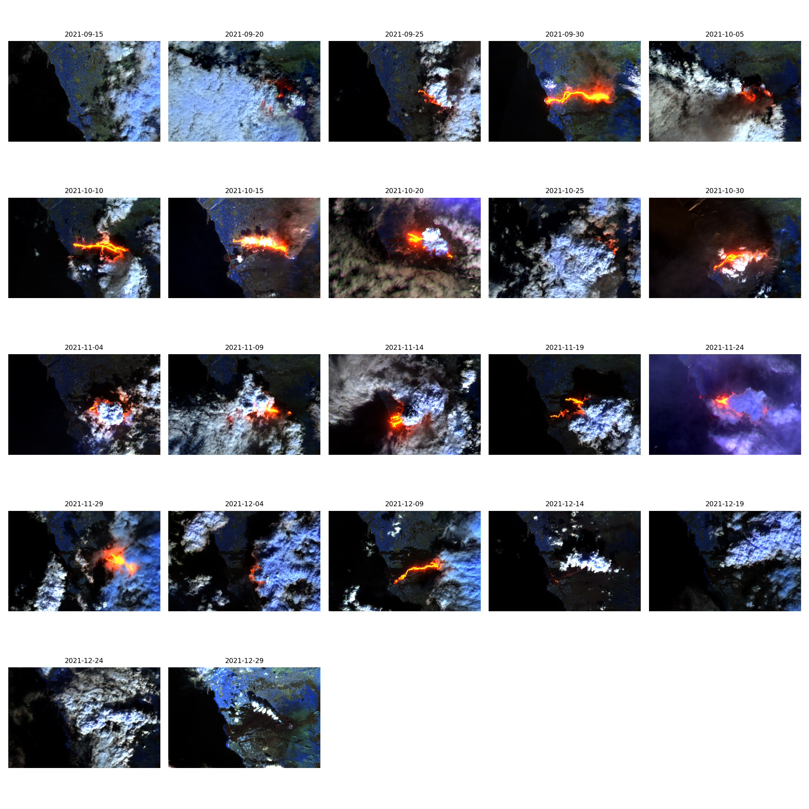

# 🌋 The Floor Is Lava: La Palma 2021

Watching the 2021 La Palma eruption from space, using Sentinel-2 satellite imagery and Python.

## What this shows

On 19 September 2021, a new volcano (now named Tajogaite) erupted on La Palma in the Canary Islands. It erupted for 85 days, until 13 December 2021, sending lava west across the island and into the sea.

This project tracks the eruption in **shortwave infrared (SWIR)**. Hot lava glows strongly at SWIR wavelengths, so active flows show up bright orange-red, even through thin smoke. The gallery runs from **15 September 2021** (four days before the eruption: no glow) to **29 December 2021**.

## How it works

1. **Search:** query a satellite catalogue (STAC) for Sentinel-2 images over the volcano between two dates
2. **Get the cards:** each result is a catalogue entry with the date, cloud cover and links to the image files
3. **Load the pixels:** download only the three bands needed, and only for a small box around the volcano
4. **Make the pictures:** combine the bands into a false-colour image for each date

**Band combination:** B12 (SWIR) → red, B11 (SWIR) → green, B8A (near infrared) → blue.
Hot lava appears red to yellow, and vegetation appears blue, because plants are very bright in near infrared.

## Data

- **Satellite:** Sentinel-2, Level-2A (Collection 1)
- **Source:** [Element 84 Earth Search](https://earth-search.aws.element84.com/v1), free, no account needed
- **Area:** around the eruption site (bbox: -17.98, 28.58, -17.84, 28.66)
- **Dates:** 15 Sept 2021 to 29 Jan 2022, giving 22 image dates
- **Resolution:** 20 m pixels

  ## Limitations

- **Clouds and ash** hide the lava on many days. Some frames show mostly cloud.
- **Only active lava glows.** Lava that has cooled stops showing in SWIR, so the glow shows where lava is *flowing*, not the full area covered.
- **Brightness varies between images**, because each one is contrast-stretched on its own.

 ## Seeing through the clouds: radar (Sentinel-1)

Clouds and ash hid the lava on many Sentinel-2 days, so I also looked at **Sentinel-1 radar**,
which sees through cloud, smoke and darkness. Radar doesn't see heat; it sees **texture**:
rough surfaces look bright, smooth surfaces look dark.

## | Before (16 Sept 2021) | Even, grainy grey texture around Las Manchas, Los Campitos and Tacande
- Clean coastline west of Las Norias.

## | During (21 Nov 2021) |**New land** on the coast west of Las Norias, where lava reached the sea and built a lava delta.

## | After (27 Dec 2021) |

## Cone Formation 
## | Before (16 Sept 2021) | No volcano yet. The map markers show where the new cone is about to form.

## | During (21 Nov 2021) | The **new cone** appears as a bright arc (the side facing the satellite) with a dark "radar shadow" behind it.

**Lesson learned:** radar images taken from different orbit directions have different shadows.
I first compared 16 Sept with 31 Dec and the hill shadows had flipped. 16 Sept and 27 Dec
are from the same orbit, so the differences are real change, not viewing angle.

*Radar images: Copernicus Sentinel-1 data (2021), viewed in Copernicus Browser. Map labels © OpenStreetMap contributors.*
  
## Tools

**SWIR (Sentinel-2):** Python · pystac-client · odc-stac · xarray · numpy · matplotlib · Google Colab
**Radar (Sentinel-1):** Copernicus Browser (Copernicus Data Space Ecosystem): Sentinel-1 IW, VV polarisation, decibel gamma0, orthorectified
